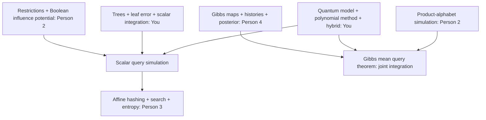

# Four-person Lean formalisation plan

Use two people on the scalar-simulation critical path, one on search/entropy,
and one on the independent classical Gibbs machinery. Once scalar simulation
is integrated, shift the first two people onto the quantum and product-alphabet
ingredients needed by Gibbs. You are Person 1 and the integration owner.

The plan concerns the **unified manuscript**, not every later research note in
this repository. The initial paper snapshot agrees byte-for-byte with
`unified_aa_simulation.tex` and its PDF at repository commit
`cdb21b7099c6fefcd9d20108dc33b3b89b7017fd`. The PDF has 36 pages. Its nine
`results/unified_aa_sections/` TeX inputs were absent from both the downloaded
copy and that repository commit. Preserve the snapshots under
`formalisation/sources/` until those inputs are recovered.

## Starting point and conventions

The Lean project is in `formalisation/`. Read its `README.md`, `RESEARCH.md`,
and `TODO.md` before choosing a lemma. The existing proof modules establish:

- Finite probability with normalized nonnegative real weights.
- Hash isolation, exact bucket/bit reconstruction, sparse-heavy selection,
  and the probability part of heavy-output extraction.
- An adapter for the supplied AA influence statement and its coarse bound.
- Deterministic oracle trees, query counts, truncation, finite potential
  telescoping, and the uniform-table truncation bound for fresh queries.

Scalar estimator existence and its query bound are **not yet formalized**.
In particular, the polynomial restriction construction, influence-potential
identity, exact conditional-mean leaf error, and quantum polynomial method
remain. The existing extraction theorem assumes estimator error and collision
bounds explicitly. The tree theorem assumes drift explicitly.

All four people use Lean **4.33.0**, the checked-in Lake manifest, and AA
commit `2a6ceaef872ae993708950f951989134084b851a`. Treat AA as proved. The
`hAA` argument in `Influence.lean` is a formal interface awaiting instantiation
with `AaronsonAmbainis.aaronson_ambainis`, not a newly open conjecture.

Freeze these shared conventions before parallel edits:

| Interface | Convention |
|---|---|
| Oracle input | `x : I → Bool`, finite coordinate type I; no oracle-dependent advice |
| Acceptance | Real-valued f in [0,1]; exact free computation between queries |
| Boolean influence | `E[(f(x)-f(flip i x))^2]`, with no factor 1/4 |
| Product-alphabet influence | Coordinate resampling; define separately from Boolean flip influence |
| Query cost | Worst-case number of physical oracle bit/cell accesses; state the cell width |
| Tree fairness | Prove freshness and uniform conditional next-bit law; do not average repeated queries as fresh coins |
| Scalar error | `Pr_X[abs(estimator(X)-f(X)) > e] ≤ delta` under the original table law |
| Probability sources | Separate table randomness, hash seeds, and repeated classical runs |
| Claim status | Distinguish proved Lean lemmas, explicit theorem hypotheses, source inputs, and missing bridges |

## Phase 1: four parallel workstreams

Paths below are relative to `formalisation/`. New module names are proposed
ownership boundaries, not claims that these files already exist.

| Person | Main responsibility | Owned modules | First reviewable merge |
|---|---|---|---|
| **1 — you** | Integration; operational trees; scalar error/truncation assembly | `DecisionTree.lean`, `DecisionTreeUniform.lean`, `Uniform.lean`; new `ScalarSimulation.lean` | A theorem combining the existing truncation bound with a correctly conditioned leaf mean-square-error bound |
| **2 — contributor** | Boolean restrictions, influence potential, AA-guided tree construction | `Influence.lean`; new `PolynomialRestrictions.lean`, `InfluencePotential.lean`, `ScalarTree.lean` | Degree/boundedness preservation and the exact one-query potential-drop identity |
| **3 — contributor** | Hashing, bounded-query search, entropy, sampling | `Hashing.lean`, `Extraction.lean`; new `AffineHashing.lean`, `SearchAlgorithm.lean`, `Entropy.lean`, `Sampling.lean` | Instantiate the existing collision hypothesis with a finite affine hash family and prove the exact predicate count |
| **4 — contributor** | Gibbs measure and classical history/posterior machinery | New `Gibbs/Model.lean`, `Gibbs/SparseMaps.lean`, `Gibbs/Histories.lean`, `Gibbs/Posterior.lean` | Exact finite Gibbs/pinning model and one fully proved sparse-update-map lemma |

### Person 1: your integration and scalar-error track

1. Own the public signatures and theorem-status map. Merge other people's
   code, pin tool versions, and keep the aggregate `UnifiedAA.lean` buildable.
2. Formalize the conditional-mean leaf semantics of a decision tree. The
   current node summary is an arbitrary real number; prove it is the correct
   conditional mean for the constructed scalar tree.
3. Prove the leaf Chebyshev/mean-square-error contribution under the actual
   conditional leaf laws, then sum over the leaf partition. Allocate
   `tau = e^2 * delta / 2` and separate the delta/2 truncation allowance.
4. Combine Person 2's drift/tree construction with the existing K-query
   truncation machinery. Make integer rounding and Q=0 explicit.
5. Start the shared quantum-query definitions needed by Phase 2: oracle
   registers, ordinary/coherent query conventions, and physical query cost.
   Agree on those types with Person 4 before implementing the Gibbs hybrid.

**Hand-off to Person 2:** a target theorem for the tree construction with
freshness, exact leaf summaries, boundedness/degree invariants, and drift.
The present drift API uses a potential function on subtrees. If two contexts
produce the same subtree but need different potentials, agree on a state
annotation or a recursive drift witness before constructing the tree.

### Person 2: Boolean AA to a scalar decision tree

1. Define partial assignments and restricted polynomials. Track the unread
   coordinate set so freshness is proved structurally.
2. Prove degree and [0,1]-boundedness preservation, and zero-degree/zero-
   variance base cases. Align the uniform mean with `cubeMean` in the adapter.
3. Prove the Boolean potential identity in the manuscript's convention:
   `Phi(f) - (Phi(f|i=0)+Phi(f|i=1))/2 = Inf_i(f)`.
4. Prove `Phi(f) ≤ d` for degree at most d and values in [0,1], with the
   Fourier/Parseval normalization fully exposed.
5. Import the supplied proved AA theorem, choose a deterministic influential
   unread coordinate, and construct the finite fresh tree. Supply Person 1's
   drift hypothesis, using the saved coarse epsilon^8/d^12 consequence.

**Completion criterion:** the dependence polynomial in degree, inverse
accuracy, and inverse exception is proved, including rounding constants.
Do not silently replace the manuscript's bounds with a different asymptotic
statement. A stronger bound is welcome with an explicit comparison lemma.

### Person 3: search and certified randomness

1. Prove pair collisions for independent affine hashes over F2, without an
   unneeded full-rank restriction. Hashes are fixed independently of the table.
2. Build a classical query program that runs the fixed bucket and bucket-bit
   estimators, reconstructs all candidates, and performs exact verification.
3. Parameterize that construction by a **stated scalar simulation theorem**
   and an exact verifier interface. This lets the track compile before
   Persons 1–2 discharge the scalar input; it must remain visibly conditional.
4. Prove the full cost `B(L+1)F(Q,t/16,rho/(4B(L+1))) + BV`, then the
   tablewise exceptional set and independent repetition of Corollary 4.2.
5. Formalize accepted-law min-entropy, its heavy atom, and the classical
   soundness contradiction. Then handle leftover hashing, global acceptance
   reweighting, and the two-bank sparse sampler.

**Hand-off to Person 1:** the fixed-output-postprocessing lemma required to
apply scalar simulation to every bucket predicate. Each estimator family
must be selected before sampling the oracle; earlier successful estimates
do not authorize invoking uniform-table AA on a conditioned table law.

### Person 4: the independent classical Gibbs track

1. Formalize finite-spin Gibbs weights, finite parameters, arbitrary fields,
   weighted interaction strength, and positive-probability pinnings.
2. Prove the signed-parity/constant update-map construction and exact one-site
   conditional law (manuscript Lemma 3.1).
3. Prove stationary history disintegration and the path-counting forward
   discrepancy estimate (Lemmas 3.2–3.3).
4. Implement lazy posterior reveal semantics and prove its exact joint law
   and expected physical-spin work bound (Lemma 3.4).

**Hand-off to Persons 1–2:** a coherent source-evaluation specification, the
exact coupling/mismatch quantity, the posterior work bound, and all their
hypotheses. The final Gibbs query theorem awaits the product-alphabet and
quantum results in Phase 2; these are separate proof obligations.

## Phase 2: share the expensive quantum/Gibbs dependencies

Reallocate once the scalar interface is stable, rather than leaving one
person with the entire Gibbs proof.

| Person | Next deliverables |
|---|---|
| **1 — you** | Quantum acceptance-polynomial theorem with degree ≤2Q; physical query composition; recursive hybrid/coupling framework and final integration |
| **2** | Product certificate inequality, finite-alphabet adversary weights, influence-guided product trees, and real-valued product simulation (Lemmas 3.5–3.8) |
| **3** | YZ list-recovery instantiation and refined classical soundness (5.1–5.3); honest preimage preparation and state-error propagation (5.4–5.5) once quantum types are available |
| **4** | Complete Gibbs history/posterior estimates, work truncation and constants; integrate Persons 1–2's hybrid/product simulator into Theorem 3.10 |

Persons 1 and 4 jointly review Lemma 3.9's recursive hybrid proof. Person 2
reviews the query composition. Person 3's honest-preparation theorem uses the
same agreed quantum model; it should not introduce a competing state/query
formalism. Coding-theory and other external inputs must have exact statements
and remain explicit hypotheses until proved or imported.



## Working and review rules

1. Give each person a branch or worktree. Suggested branches:
   `formalisation/integration`, `formalisation/boolean-aa`,
   `formalisation/search-entropy`, and `formalisation/gibbs-histories`.
   Branch them from a common reviewed formalisation checkpoint.
2. Only you edit the shared aggregate import file, dependency pins,
   `FiniteProbability.lean`, and axiom-audit manifest during integration.
   Contributors propose shared helper/signature changes in a small separate
   commit before using them throughout a track. Changes to another owner's
   module need that owner's review.
3. Agree on theorem signatures first. Record missing mathematical inputs as
   explicit hypotheses or separate propositions. Never use `axiom`, `sorry`,
   `admit`, or disabled kernel checking to make an incomplete result look proved.
4. Submit one bounded mathematical result per PR, with the manuscript page/
   label, exact hypotheses, proof status, build command, and audit result.
   Avoid concurrent rewrites of the manuscript during a formal proof change.
5. Each owner runs the relevant module build. Before merge, you run:

   ```sh
   cd formalisation
   lake build
   sh scripts/check.sh
   uv run --no-project python checks/check_axiom_audit.py
   ```

   Extend both the named Lean audit and its expected theorem set for new
   headline results. A full local upstream AA rebuild is distinct from
   checking our adapters; state which was completed. Bound parallel Lean
   jobs to available memory when working on a small machine.
6. Review rotation: you review Person 2's normalization/potential identities;
   Person 2 reviews your leaf conditioning and scalar constants; Person 4
   reviews Person 3's probability-conditioning arguments; Person 3 reviews
   Person 4's posterior/disintegration probability bookkeeping. Owners still
   obtain specialist review for quantum and coding hypotheses when needed.
7. Update the theorem-status map after each merge. Record failed approaches
   and remaining gaps. A record/interface with a hypothesis is not a proof
   of the theorem supplying that hypothesis. Numerical checks remain evidence,
   separate from universal Lean theorems.

## Merge milestones

- **M1 — classical scalar core:** fresh polynomial-restriction tree, proved
  influence drift, exact leaf means, leaf-error sum, and truncation constants.
- **M2 — operational AA scalar theorem:** connect M1 to the proved AA theorem
  and quantum degree bound; show the manuscript's scalar query guarantee.
- **M3 — extraction branch:** discharge the existing hash/estimator hypotheses,
  prove the search costs, then entropy, conditioning, and sparse sampling.
- **M4 — correlated-input branch:** combine exact Gibbs histories, posterior
  access, product-alphabet simulation, and quantum hybrid with all query costs.
- **M5 — full manuscript coverage:** complete coding and honest preparation,
  reconcile every claimed result against the frozen source, and run the final
  build/axiom audit with all remaining assumptions listed.

The principal early bottleneck is M1/M2. Keep Persons 1–2 focused on that
shared critical path while Persons 3–4 prove independent prerequisites.
